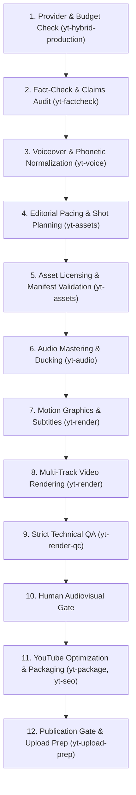

# yt-studio — Master Hybrid Video Production Studio v3.0

`yt-studio` is the overarching production orchestrator for YouTube Agent Studio v3.0, maintained by **ABDUL MUEED LASHARY** (building on upstream foundations by Jake Schincariol). It connects ideation, scriptwriting, voiceover, stock footage sourcing, audio mastering, timeline assembly, and technical QA into a cohesive, zero-credit hybrid documentary workflow.

## The 12-Step Hybrid Production Pipeline



## Production Principles

1. **Hybrid Provider Resolution & Zero-Credit Baseline**:
   - Operations default to a **0-credit budget**.
   - If connected and authorized APIs have quota, they can be utilized; otherwise, local open-source tools (FFmpeg, Piper Urdu, Python stdlib) execute the complete workflow.
   - Third-party accounts are never charged without explicit confirmation and cost estimates.

2. **Real Documentary Footage Over Synthetic Slides**:
   - Curates 70–95 authentic stock cuts per 6–7 minute timeline from permissive repositories (Pexels, Pixabay, Mixkit, CC0).
   - Rejects static slides, robotic morphs, or fake AI 3D building animations.

3. **Authentic Pakistani Urdu Voiceover**:
   - Narration is written and vocalized in native Perso-Arabic Urdu script (`اردو`).
   - Evaluated against a mandatory 20–40s benchmark passage covering numbers (`بیالیس ہزار`, `چھ ہزار`, `چھتیس ہزار`), regulatory bodies (`سی ڈی اے`, `این او سی`, `ایس ای سی پی`, `نیب`), and geographic entities (`اسلام آباد`).
   - Targets ~130 words per minute for calm, authoritative investigative delivery.

4. **Broadcast Audio Standards**:
   - Voiceover normalized to **-14.0 LUFS** with a **-1.5 dBFS** true peak ceiling.
   - Background music ducked automatically to **-24.0 dB** beneath speech.
   - Missing music produces an explicit `MISSING_MUSIC_WARNING` to prevent unintended silent ambience.

5. **Reported Allegations vs Legal Convictions**:
   - All investigative figures (such as 42,000 files vs 6,000 plots, Rs 16B inquiry, 7 arrests) are strictly identified as **REPORTED ALLEGATIONS** (`رپورٹ کردہ الزامات`).
   - Subtitles and disclaimers clearly state that arrest does not constitute conviction and that stock media is illustrative.

6. **Strict Duration & Technical QA Gate (`TECHNICALLY_VALID_PENDING_REVIEW`)**:
   - Renders are strictly verified against target duration bounds (360.0s – 420.0s for 6–7 minute documentaries); short videos fail QA immediately.
   - Black frame detection, EBU R128 loudness analysis, and license compliance must pass before human sign-off.
   - Automated checks never bypass mandatory human audiovisual review.

## Pipeline Command Walkthrough

```bash
# 1. Resolve hybrid providers & verify credit budget
python3 scripts/provider_engine.py --status

# 2. Analyze screenplay word count & normalize numbers/acronyms
python3 scripts/urdu_voice_engine.py --script templates/documentaries/pakistan_property_screenplay.txt --normalize

# 3. Generate 70-95 shot EDL from licensed asset manifest
python3 scripts/stock_director.py --manifest Stock_Footage_Manifest_22.csv --duration 390.0 --out edit_decisions.json

# 4. Mix voiceover and background music (-14 LUFS, -24 dB ducking)
python3 scripts/audio_manager.py --voice voiceover.wav --music background_music.mp3 --duration 390.0 --out master_audio.m4a --meta audio_mix.json

# 5. Generate cue-synchronized ASS motion subtitles with allegations disclaimers
python3 scripts/editorial_motion.py --cues voice_cue_times.json --output documentary_motion.ass

# 6. Render master 1080p MP4 documentary
python3 scripts/render_free.py --manifest project-manifest.json --audio master_audio.m4a --subtitles documentary_motion.ass --output exports/master_documentary.mp4

# 7. Execute strict technical QA (enforcing 360-420s bounds)
python3 scripts/qa_media.py --media exports/master_documentary.mp4 --manifest project-manifest.json --min-duration 360.0 --max-duration 420.0 --require-music
```
