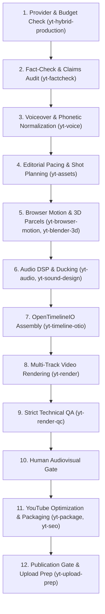

# yt-studio — Master Motion-First Hybrid Video Production Studio v3.0

`yt-studio` is the overarching production orchestrator for YouTube Agent Studio v3.0 (ChatGPT Edition), maintained by **ABDUL MUEED LASHARY** (building on upstream open-source foundations by Jake Schincariol). It connects ideation, scriptwriting, voiceover, stock footage sourcing, browser-based motion graphics, Blender 3D architectural rendering, Spotify Pedalboard audio mastering, timeline assembly, and technical QA into a cohesive, zero-credit hybrid documentary workflow.

---

## The Three Creator Production Options

> [!IMPORTANT]
> **Production Choice Gate**: The three options below are presented **ONLY** when the creator requests video, motion graphics, audio mastering, or timeline generation. They are **never** shown for pure ideation, scriptwriting, title linting, or SEO requests.

When entering video production, creators choose from three clear paths:

```
┌─────────────────────────────────────────────────────────────────────────────┐
│                       YOUTUBE AGENT STUDIO v3.0                             │
│                      Choose Your Production Mode                            │
├─────────────────────────────────────────────────────────────────────────────┤
│  [A] FREE STUDIO (Zero Budget / 100% Offline Local Engine)                  │
│      • Cost: $0.00 | API Keys: None required | Internet: Not required      │
│      • Browser Motion: Deterministic HTML5/SVG/Canvas via Headless Chrome   │
│      • 3D Visualization: Procedural 3D parcels & flyovers via Blender LTS   │
│      • Voiceover: Offline Piper Urdu neural TTS or human microphone WAV     │
│      • Audio DSP: Spotify Pedalboard + FFmpeg Broadcast Loudnorm (-14 LUFS) │
│      • NLE Export: OpenTimelineIO (.otio, .edl) for DaVinci / Premiere      │
│                                                                             │
│  [B] HYBRID VALUE (Pennies / Low-Cost High-Fidelity APIs)                   │
│      • Cost: < $0.05 per documentary | Checked quotas & price-guard         │
│      • Voiceover: Gemini Voice / Cloud TTS for ultra-natural Urdu inflection│
│      • Rendering: Free local browser motion & Blender 3D engine             │
│      • Fallback: Gracefully falls back to Option A if quota exhausted       │
│                                                                             │
│  [C] vidIQ / PREMIUM (Credit-Guarded Commercial Provider)                   │
│      • Cost: Verified vidIQ balance deducted with explicit authorization   │
│      • Balance Check: Credit Guard audits available tokens before any call  │
│      • Auto-Protection: Falls back to Option A/B if balance insufficient    │
└─────────────────────────────────────────────────────────────────────────────┘
```

---

## The 12-Step Motion-First Hybrid Production Pipeline



---

## Core Production Principles

1. **Deterministic Browser Motion Graphics**:
   - Uses `scripts/browser_motion.py` to capture frame-by-frame HTML/CSS/SVG/Canvas animations.
   - Outputs broadcast Full HD (1920x1080, 1080x1920 9:16 Shorts, 1080x1080 square).
   - Generates contact sheets and review preview frames for rapid visual inspection.

2. **Real Blender 3D Architectural & Land Visualization**:
   - Uses `scripts/blender_parcel_render.py` with Blender LTS headless Python (`bpy`).
   - Replaces flat CSS cards with procedural 3D land parcels, boundary grids, and structural representations of the 6,000 plots vs 42,000 files.

3. **Broadcast Voice Mastering with Spotify Pedalboard & FFmpeg**:
   - Uses `scripts/pedalboard_master.py` for Highpass (80Hz), NoiseGate (-45dB), Compressor (-18dB, 3:1), and Limiter (-1.5dBFS).
   - Normalizes voiceover to **-14.0 LUFS** broadcast standard.
   - Sidechain ducking attenuates background music by **-24.0 dB** during spoken narration.

4. **Multi-Track OpenTimelineIO Interchange**:
   - Uses `scripts/otio_export.py` to generate `.otio` and `.edl` projects.
   - Integrates video footage, 3D parcel renders, motion graphic overlays, and audio stems directly into DaVinci Resolve, Adobe Premiere Pro, and Final Cut Pro.

5. **Reported Allegations vs Final Adjudications**:
   - All investigative figures (such as 42,000 files vs 6,000 plots, Rs 16B inquiry, 7 arrests) are strictly identified as **REPORTED ALLEGATIONS** (`رپورٹ کردہ الزامات`).
   - Prominent legal disclaimers are burned into both subtitles and motion graphic lower-thirds.

6. **Strict Technical QA Gate (`TECHNICALLY_VALID_PENDING_REVIEW`)**:
   - Renders are strictly verified against target duration bounds.
   - Black frame detection, EBU R128 loudness analysis, and license compliance must pass before human sign-off.

---

## Complete Command Walkthrough

```bash
# 1. Check system readiness (Chrome, Blender, FFmpeg, Pedalboard, OTIO)
python3 scripts/browser_motion.py check
python3 scripts/blender_parcel_render.py check
python3 scripts/pedalboard_master.py check
python3 scripts/otio_export.py check

# 2. Render 15-second browser motion graphics demo with contact sheet
python3 scripts/browser_motion.py render \
  --html templates/motion/discrepancy_counter.html \
  --out output/demo_motion_15s.mp4 \
  --duration 15.0 --fps 30

# 3. Render 3D procedural land parcel visualization via Blender
python3 scripts/blender_parcel_render.py render \
  --out output/blender_parcel_3d.png \
  --frames 60 --fps 30

# 4. Master voiceover and apply -24 dB sidechain ducking
python3 scripts/pedalboard_master.py master \
  --voice assets/voice/urdu_narration.wav \
  --out output/urdu_mastered.wav

python3 scripts/pedalboard_master.py mix \
  --voice output/urdu_mastered.wav \
  --music assets/audio/ambient_bed.mp3 \
  --out output/full_audio_mix.wav

# 5. Export multi-track timeline for NLE editing (.otio, .edl)
python3 scripts/otio_export.py export \
  --manifest Stock_Footage_Manifest_22.csv \
  --motion output/demo_motion_15s.mp4 \
  --blender output/blender_parcel_3d.png \
  --voice output/urdu_mastered.wav \
  --music output/full_audio_mix.wav \
  --out output/documentary_timeline.otio

# 6. Execute strict technical QA
python3 scripts/qa_media.py \
  --media output/demo_motion_15s.mp4 \
  --min-duration 10.0 --max-duration 30.0
```
