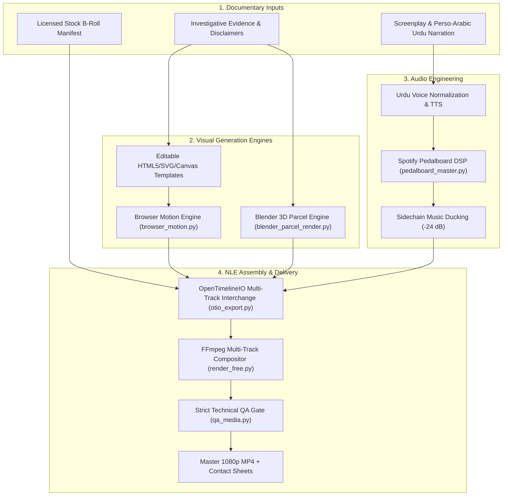

# YouTube Agent Studio v3.0 — Motion-First Architecture

**YouTube Agent Studio v3.0**
Extension Maintainer: **ABDUL MUEED LASHARY**
Original Upstream Author: **Jake Schincariol** (MIT License)

This document describes the architectural transition from static documentary slides to a **motion-first, broadcast-grade hybrid video production pipeline**.

---

## 1. System Architecture Overview

---

## 2. Core Technological Components

### A. Deterministic Browser Motion Graphics (`shared/scripts/browser_motion.py`)
- **Technology**: Headless Google Chrome / Microsoft Edge + Canvas 2D / SVG + FFmpeg.
- **Why Deterministic?** Screen recorders capture frames in real time, dropping frames whenever the CPU spikes. Our streaming server requests each frame index `0, 1, ..., N-1` explicitly, capturing every frame deterministically at 23.4+ FPS.
- **Editable Source**: All motion scenes are clean HTML5 files (`templates/motion/`) using CSS easing, SVG geometry, and native Urdu typography.

### B. Procedural 3D Parcel & Land Visualization (`shared/scripts/blender_parcel_render.py`)
- **Technology**: Blender LTS headless Python (`bpy`).
- **Scene Design**:
  - Ground Plane: 200m master site with road network and survey sectors.
  - 6,000 Plots: Realistic physical residential pads with emerald zoning demarcations.
  - 42,000 Files: 45m towering monolith / certificate stack displaying the 700% over-allocation in 3D perspective.
  - Motivated Camera: 35mm wide lens orbiting on a smooth bezier path with soft sunlight and cool rim lighting.

### C. Broadcast Audio Engineering (`shared/scripts/pedalboard_master.py`)
- **Technology**: Spotify's Pedalboard DSP library + FFmpeg Loudnorm.
- **Dialogue Chain**:
  - Highpass Filter: 80 Hz cutoff.
  - Noise Gate: -45 dB threshold (2.5:1 ratio).
  - Compressor: -18 dB threshold (3:1 ratio).
  - Limiter: -1.5 dBFS ceiling.
  - Broadcast Standard: -14.0 LUFS integrated loudness, LRA 7.0.
- **Sidechain Ducking**: Music is automatically attenuated by -24.0 dB beneath dialogue segments.

### D. Multi-Track NLE Interchange (`shared/scripts/otio_export.py`)
- **Technology**: OpenTimelineIO (`otio`).
- **Tracks**:
  - `V3`: Motion Graphics Overlays & Legal Disclaimers
  - `V2`: Blender 3D Architectural Flyovers
  - `V1`: Base Stock B-roll Footage
  - `A1`: Spoken Urdu Narration Dialogue (-14 LUFS)
  - `A2`: Scored Background Music (-24 dB ducking)
- **Export Targets**: `.otio`, `.edl` (CMX 3600), and `.xml` (Final Cut Pro / Premiere).

---

## 3. The Three Creator Options in `yt-studio`

1. **Option A: FREE STUDIO** ($0 Spent / 100% Offline Local Engine):
   - Fully open-source local rendering.
   - Zero API keys, zero token fees, zero third-party accounts.
2. **Option B: HYBRID VALUE** (Pennies / Low-Cost High-Fidelity APIs):
   - Adds Gemini Cloud TTS for voiceover when authorized, falling back to Option A if quota is exhausted.
3. **Option C: vidIQ / PREMIUM** (Credit-Guarded Commercial Provider):
   - Integrates vidIQ token checks via Credit Guard, requiring explicit consent before spending.
