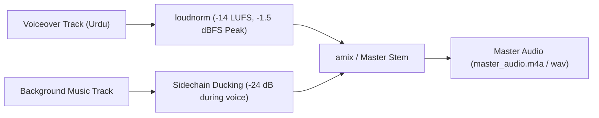

# yt-audio — Broadcast Audio Mastering & Mixing Engine v3.0

`yt-audio` orchestrates multi-track audio engineering for YouTube documentary production. It enforces EBU R128 integrated loudness standards (-14.0 LUFS), automated sidechain ducking (-24.0 dB music attenuation during narration), fade-in/out transitions, and strict detection of missing music tracks (`MISSING_MUSIC_WARNING`).

## Audio Architecture



## Core Standards

1. **Integrated Loudness**: Voiceover master is calibrated to **-14.0 LUFS** with a true peak ceiling of **-1.5 dBFS**.
2. **Sidechain Ducking**: Background music plays at -16.0 dB during pauses, ducking to **-24.0 dB** beneath speech.
3. **No-Music Warning Gate**: If no background music track is supplied, the engine outputs an explicit `MISSING_MUSIC_WARNING` in `audio_mix.json` to prevent unintentional silent ambience.
4. **YouTube Chapter Export**: Generates copy-paste YouTube description timestamps matching narrative acts.

## CLI Usage

Mix voiceover and background music into a broadcast master:

```bash
# Mix audio with automatic ducking and loudness normalization
python3 shared/scripts/audio_manager.py \
  --voice voiceover.wav \
  --music background_music.mp3 \
  --duration 390.0 \
  --out master_audio.m4a \
  --meta audio_mix.json
```

Generate YouTube chapter timestamps:

```bash
python3 shared/scripts/audio_manager.py --generate-chapters --meta audio_mix.json
```

## Output Metadata Schema (`audio_mix.json`)

```json
{
  "voice_lufs": -14.0,
  "music_attenuation_db": -24.0,
  "total_duration_sec": 390.0,
  "music_present": true,
  "missing_music_warning": null,
  "youtube_chapters": [
    {"time": "00:00", "title": "مقدمہ اور الزامات (The Hook & Allegation)"},
    {"time": "01:03", "title": "فائل بمقابلہ زمین کا زمینی سچ (Files vs Land)"},
    {"time": "01:57", "title": "تحقیقات اور قانونی حقوق (Legal Rights)"},
    {"time": "02:48", "title": "سی ڈی اے اور ریگولیٹری فریم ورک (CDA & NOC)"},
    {"time": "03:35", "title": "محفوظ خریداری کا چار نکاتی فارمولا (Due Diligence)"},
    {"time": "04:30", "title": "ایس ای سی پی انتباہات (SECP Warnings)"},
    {"time": "05:16", "title": "انسانی حقیقت اور اختتامی پیغام (Conclusion)"}
  ]
}
```
