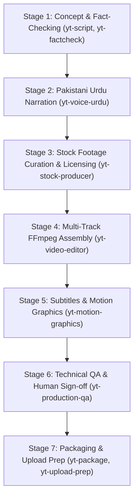

# yt-studio — Master Documentary Production Studio

`yt-studio` is the overarching production orchestrator for YouTube Agent Studio. It connects ideation, scriptwriting, voiceover, stock footage sourcing, timeline assembly, and technical QA into a cohesive, zero-credit documentary workflow.

## Studio Pipeline Stages

## Core Production Principles

1. **Free-First & Zero-Credit Baseline**:
   - Production operations default to a **0-credit budget**.
   - No paid third-party tools (vidIQ, ElevenLabs, DALL-E) are invoked without explicit creator authorization.

2. **Real Footage Over Synthetic Slides**:
   - Source authentic, high-definition stock footage from permissive repositories (Pexels, Pixabay, Mixkit, CC0).
   - Reject robotic slide shows, AI 3D morphing, or low-effort image pans.

3. **Authentic Pakistani Urdu Voiceover**:
   - Narration is written and rendered in native Perso-Arabic Urdu script (`اردو`), avoiding Roman Urdu.
   - Speech cadence targets ~130 words per minute for natural documentary weight.
   - Prioritizes human recording as the gold standard over unverified neural TTS.

4. **Deterministic Multi-Track Audio**:
   - Spoken narration normalized to **-14.0 LUFS** via FFmpeg `loudnorm`.
   - Atmospheric background music ducked to **-24.0 dB** beneath speech.

5. **Defensive Manifest & Provenance Tracking**:
   - Every asset is registered in `project-manifest.json` with source URL, license class, and verification date.
   - Run `validate_manifest.py` before touching the render pipeline.

6. **Rigorous Quality Gate (`TECHNICALLY_VALID_PENDING_REVIEW`)**:
   - Rendered media is probed via `qa_media.py` for duration, black frames, resolution, and audio loudness.
   - Automated tools report technical compliance but **never** bypass human editorial sign-off.

## Execution Walkthrough

When orchestrating a documentary video:
1. **Script & Fact-Checking**: Draft the narrative script, establishing hook, tension, and clinical/empirical grounding.
2. **Audio Track**: Record or load the voiceover track; verify timing and pronunciation.
3. **Footage Curation**: Map each script sentence to a visually compelling stock clip (minimum 2–5 seconds per cut).
4. **Assembly & Render**: Generate the manifest and execute `render_free.py` to produce a playable 1080p MP4.
5. **Technical QA**: Probe the output with `qa_media.py`, verify `TECHNICALLY_VALID_PENDING_REVIEW`, and review the 5 mandatory human checkpoints.
